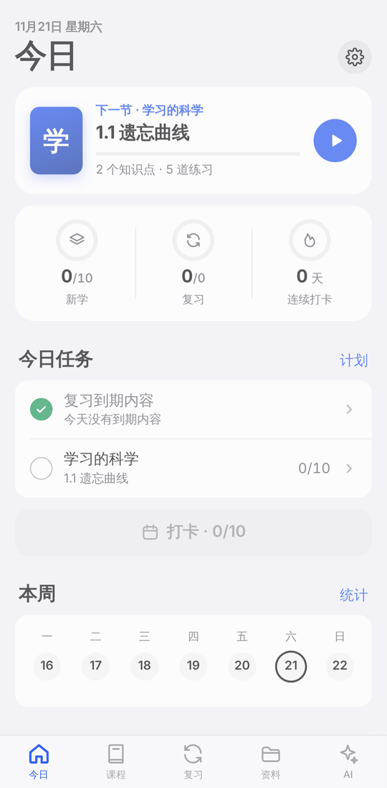
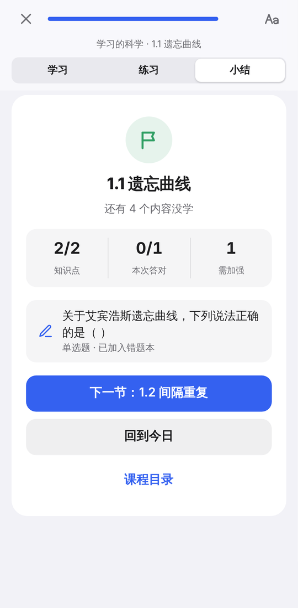

# 温新 Renew

> 温故而知新——像刷帖子一样学习的开源记忆卡片 App。

温新把知识拆成一张张卡片，按信息流的方式一张接一张地刷：知识点卡讲清楚原理，随堂小测马上检验，学完的内容按记忆规律（FSRS 算法）自动安排复习。AI 用你自己的 API Key，帮你出题、讲解、答疑，把教材整理成课程。

**数据只存在你的设备上，没有服务器，没有账号。**

<p>




</p>

## 功能

- **刷卡学习**：知识点卡（要点 + 可展开的详解）、单选、多选、判断、问答、填空、分步思考题；支持公式（KaTeX）、表格、代码、示意图和「打个比方 / 易错 / 怎么考」等提示块
- **学习流程**：每一节分为「学习 → 练习 → 小结」，答错的题自动进入错题本
- **间隔复习**：FSRS 算法为每张卡片单独安排复习时间，可设置目标记忆保持率和每日上限
- **进度规划**：设置每天新学多少、计划完成日期；在别处学过的章节可以标记为「别处已学」
- **AI（自带 Key）**：DeepSeek、通义千问、Kimi、智谱、Claude、OpenAI 或任意 OpenAI 兼容接口
  - 就某张卡片提问、生成详解、补充练习题、修正内容
  - 导入 PDF / Word / 照片 / 文字，整理成带讲解和练习的新课程
  - 对话式助手，可以查看和调整你的学习计划（修改前会征得你同意）
- **阅读排版**：字号、行距、公式、代码、表格大小都可以调整，适配手机屏幕
- **本机数据**：学习记录、笔记、资料都在设备上；可导出完整备份、课程包、Markdown 笔记、Anki 卡片
- **App 体验**：每日复习提醒、触感反馈、页面转场与手势（边缘右滑返回、下拉关闭）、深色 / 护眼主题

## 下载

在 [Releases](https://github.com/NIKOPACK/Renew/releases) 下载 Android 安装包。iOS 版需要自行用 Xcode 编译（见下文）。

## 课程内容

仓库自带一门示例课程「学习的科学」（`content/learn.txt`），介绍记忆规律、高效学习方法和温新的用法。

你可以：

- 在 App 的「资料」页导入教材，让 AI 整理成课程；
- 按 [课程格式](docs/content-format.md) 用纯文本自己写课程，导入或编译进 App；
- 导入别人分享的课程包（`.renew.json`）。

## 开发

需要 Node.js 20+ 和 Python 3。

```bash
npm install
npm run build        # 编译课程内容，构建 App（www/）与网页单文件版（dist/artifact/）
npm run serve        # 在浏览器预览 App：http://localhost:8780
npm test             # 端到端测试（首次需要 npx playwright install chromium）
```

打包手机 App（[Capacitor](https://capacitorjs.com)）：

```bash
npm run android      # 构建并用 Android Studio 打开（或 cd android && ./gradlew assembleDebug）
npm run ios          # 构建并用 Xcode 打开（需要 macOS）
```

把私有课程放在仓库外并一起编译：`RENEW_CONTENT=../my-courses npm run build`。

更多文档：

- [架构说明](docs/architecture.md)：源码结构、平台适配层、数据存储
- [课程格式](docs/content-format.md)：卡片文本格式与课程包格式
- [AI 服务](docs/ai-providers.md)：支持的服务商、接口协议与隐私
- [发布](docs/release.md)：版本号、签名与自动发布

## 参与贡献

欢迎提交 Issue 和 Pull Request，详见 [CONTRIBUTING.md](CONTRIBUTING.md)。

## 许可证

[MIT](LICENSE)

---

## English

**Renew** is an open-source, feed-style flashcard app: scroll through knowledge cards and quizzes like a social feed, with FSRS spaced repetition, bring-your-own-key AI (DeepSeek, Qwen, Kimi, GLM, Claude, OpenAI or any OpenAI-compatible endpoint), and all data stored locally on your device. Built with plain JavaScript and [Capacitor](https://capacitorjs.com) for Android and iOS. The UI is currently in Chinese. Licensed under MIT.
