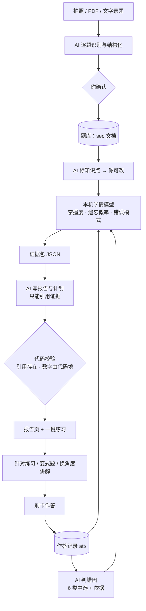
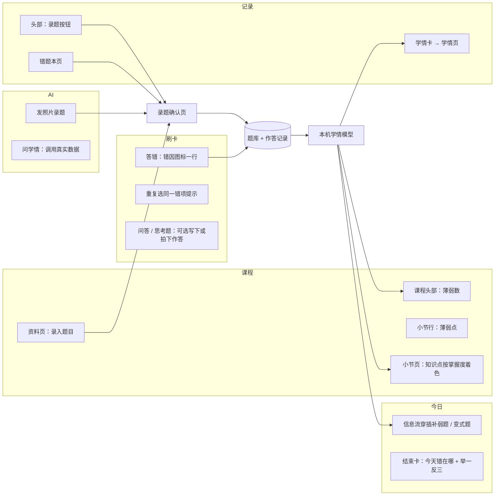

# AI 学情分析与提分：调研与方案

> 目标：能上传题目和错题、记录每次做题，AI 依据这些数据分析学习情况，并带着你把薄弱处补上来。分析结论必须可靠。

## 结论

调研后的核心判断：**大模型适合看懂题、看懂错在哪、把结论讲清楚，不适合直接算掌握度或编造数据**。研究里大模型出错，大多出在三处：识别图片和手写（转写）、在很多候选错因里挑选、自己生成的题答案有误或有多个说得通的答案。所以方案把「算」和「说」分开：

1. **数字全部由本机代码算出来**（正确率、掌握度、遗忘概率、趋势），并给出样本量和可信区间；数据不够时直接显示「数据不足」，不下结论。
2. **大模型只做三件事**：识别和整理题目、判断错因、把本机算好的证据写成报告和计划。每一处都有校验：识别结果要你确认，错因从少量固定类别里选并附依据，报告里的数字由代码填进去，模型写不了数字。
3. **准确度要能量出来**：App 用你后来的真实作答检验掌握度预测准不准（校准度、对数损失），开发时用一套标注好的测试题，在不同模型上测出识别、判题、错因、出题的准确率。

## 一、现状

| 已有 | 位置 | 对本功能的意义 |
|---|---|---|
| FSRS 记忆状态（稳定度 s、难度 d、复习次数、遗忘次数、上次评分） | `020-fsrs.js`、`srs/<课程>` | 可以算出任意时刻的回忆概率 R，是「记忆」维度的现成模型 |
| 错题本（`lapses > 0` 且未移出） | `025-derive.js` `wrongItems()` | 只知道「错过几次」，不知道错在哪、选了哪个错项 |
| 每日汇总、每小节当天的新学 / 复习 / 对 / 错 | `app/state` 的 `stats`、`hist` | 只有计数，没有逐题记录 |
| 资料导入、AI 识别文字、AI 出题 | `120-materials.js`、`ocrSheet()`、`genPrompt()` | 识别和出题的流程可以复用 |
| AI 助手的工具调用（含 `get_weak_points`） | `155-assistant.js` | 分析结果可以作为新工具交给助手 |
| 安全的表达式求值（不用 eval） | `032-viz.js` `compile()` | 可以用来复核计算题的数值答案 |

**缺的关键一环：逐次作答记录**。`rate()`（`090-session.js`）作答后只更新 FSRS 状态和当天计数，选了哪个选项、用了多久、看了几步提示、是第几次做都没有存。没有这份记录，「学情分析」只能根据汇总数字猜，精准无从谈起。所以第一步是补上作答记录。

## 二、调研结论与对方案的影响

| 发现 | 对方案的影响 |
|---|---|
| 手写数学阅卷研究中，最好的模型约 87% 的错误来自**转写**而不是判分；常见问题是图片质量、凭空补内容、等价表达式判错；多行手写公式还会被模型「过度纠正」 | 拍照录题必须有**确认页**：原图和识别结果并排，你确认后才入库；按题目区域逐题识别，不整页一起识别 |
| 小数据上，**PFA / 逻辑回归类知识追踪模型最准**，深度模型（DKT）要大量数据才占优；BKT、PFA 参数少、可解释 | 掌握度用可解释的统计模型在本机算，不用大模型「估计」掌握度；数据多了再拟合 PFA，并用真实作答检验哪个更准 |
| 大模型判断数学误概念：候选少时准确率高（4 选 1 约 92%），**候选越多准确率下降越明显**；总体准确率高也可能掩盖某些题型上的集中失败 | 错因只从 **6 个固定类别**里选，并先用本机规则把候选缩小；按题型分别统计准确率，不只看总数 |
| 大模型自动给题目标知识点，比专家标注差，但和人工修正结合可用 | 题目→知识点由 AI 先标，**候选限定在本课程已有知识点卡**，你可以一键改；未标的题退回按小节归类 |
| 大模型生成的选择题，最常见的问题是**答案错或不止一个答案说得通** | 变式题要经过「不看答案独立做 3 次、多数一致且与给定答案相同」才保留；计算题再用表达式求值复核数值 |
| 多次采样投票（self-consistency）能提高答案可靠性，用程序验证候选答案比单纯投票更好 | 判题和验证答案时多次独立作答投票；计算题让模型同时给出可求值的算式，由代码核对 |
| 实际部署的 AI 阅卷系统都保留「模型多次运行 + 一致性检查 + 人工复核少数异常」 | 模型不一致或置信度低的结果标为「待确认」，不进入分析，等你确认 |

## 三、总体设计



原则：

- **事实只有一个来源**：作答记录和题库。模型的输出不能改写事实，只能附加带来源标记的判断（如错因标签 `by: 'ai' | 'me'`），你的判断优先。
- **不确定就说不确定**：每个结论都带样本量；样本不足、区间太宽、模型多次结果不一致，都显示为「数据不足」或「待确认」。
- **全部在本机**：作答记录和分析都存在设备上，发给模型的只有生成报告所需的证据包。

## 四、模块设计

### 4.1 作答记录（数据底座）

新增文档 `att/<YYYY-MM>`（按月分文件，避免单个文档过大），在 `rate()` 中写入一条：

```js
{
  id: 'ds-1.2-x3k',     // 卡片 id
  t: 1764300000000,     // 作答时间
  m: 'review',          // 来源：learn / practice / review / wrong / star / variant / paper（纸上作答补录）
  g: 3,                 // 评分 1~4
  ok: true,             // 是否答对（题目才有）
  ans: [1],             // 作答内容：选项下标 / 判断真假 / 填空翻开情况 / 问答自评
  ms: 23400,            // 用时：卡片进入视口到作答
  hint: 1,              // 思考题看了几步提示
  r: 0.82,              // 作答前 FSRS 预测的回忆概率（之后用来检验预测准不准）
  first: true           // 是否是当天这张卡的第一次作答（答错后重新排进队列的不算）
}
```

要点：

- 只用「当天第一次作答」计算掌握度，答错后马上重做答对不能抵消。
- `r` 在评分前用 `retr()` 算好存下，这是之后检验模型准确度的依据。
- 用时从卡片进入视口开始算，超过 10 分钟截断（离开 App 的情况）。
- 加入 `DOC_RE` 与云端同步列表，随完整备份导出；旧数据无法补出逐次记录，只从 FSRS 状态生成一条「历史摘要」，分析时单独标注。

### 4.2 题目与错题录入

入口：课程的「资料」页和错题本页增加「录入题目」。

1. **来源**：拍照、相册、PDF、Word、粘贴文字（复用 `058-composer` 的附件和 `120-materials` 的解析）。
2. **逐题识别**：视觉模型先返回每道题的区域，再逐题转写，输出结构化结果：题干、选项、标准答案（有就填）、**你的作答**、题型、原图区域。公式用 LaTeX。
3. **确认页**：每道题一张卡，左边原图裁剪，右边识别结果，可以直接改；标出模型不确定的字段（多次识别结果不一致处高亮）。确认后才入库。
4. **答案来源分级**：
   - 你给的答案或试卷答案：直接用。
   - 没有答案：模型不看你的作答，独立解 3 次，多数一致才填入并标「AI 解答」；计算题同时给出算式，由 `compile()` 复核数值；不一致则标「答案待确认」，这道题不参与判对错和分析。
5. **入库**：存为课程下「我的题目」小节的卡片（`sec/<id>` 文档，沿用现有卡片格式，新增 `src: 'import'`、`img` 原图引用），同时把你当时的作答写成一条 `m: 'paper'` 的作答记录。错题直接进入错题本和 FSRS 复习。
6. **去重**：用 `stableCardId()` 的同一哈希思路，加上题干文字相似度，重复录入时提示合并。

### 4.3 题目→知识点

- 每道题有 `kps: [知识点卡 id]`。内置课程和 AI 生成的内容，在生成时一并标注；录入的题目由 AI 标注。
- **候选限定**：只能从本课程已有的知识点卡里选（先按小节和关键词检索出前 15 个候选，再让模型选 1~3 个），选不出就归到小节层级，不让模型自造知识点。
- 卡片菜单里可以改标注，改过的以你为准（`kpsBy: 'me'`）。

### 4.4 学情模型（本机计算，不用大模型）

**记忆**：每张卡用 FSRS 算当前回忆概率 R；知识点的记忆强度取其知识点卡和关联题目的 R 平均。

**掌握度**：对每个知识点，取关联题目的「当天第一次作答」，按时间衰减加权（半衰期 30 天，越近权重越大），用 Beta 分布估计答对概率：

```
α = 1 + Σ wᵢ·答对ᵢ       β = 1 + Σ wᵢ·答错ᵢ       wᵢ = 0.5^(距今天数/30) ÷ 该题关联的知识点数
掌握度 = α / (α + β)，同时给出 80% 区间
```

状态划分：

| 状态 | 条件 |
|---|---|
| 数据不足 | 有效作答数 Σw < 3 |
| 薄弱 | 区间上界 < 0.6 |
| 已掌握 | 区间下界 ≥ 0.8 且记忆强度 ≥ 0.85 |
| 巩固中 | 其余 |

数据积累后（某课程超过 300 次作答），在本机拟合 PFA 逻辑回归（每个知识点一个难度参数，加上做对、做错次数的系数），用最近 20% 的作答做留出检验；只有对数损失明显优于上面的 Beta 基线才启用。

**错误模式**（纯规则，作为证据和错因的先验）：

| 信号 | 规则 | 倾向的错因 |
|---|---|---|
| 从没做对过 | 该题所有作答都错 | 概念不清 / 方法不会 |
| 做对后隔一段时间错 | 作答前 R < 0.7 | 遗忘 |
| 记得应该很牢却错 | 作答前 R ≥ 0.9 | 概念偏差 / 粗心 |
| 用时很短就错 | 用时 < 该题型中位数的 30% | 审题 / 粗心 |
| 反复选同一个错项 | 同一错误选项 ≥ 2 次 | 稳定的误概念 |
| 依赖提示 | 思考题看完全部提示才做出 | 方法不熟 |

### 4.5 错因诊断

- 固定 6 类：**概念不清、方法不会、记忆遗忘、审题失误、计算失误、粗心**。另可附一句具体的误概念描述（如「把栈顶当成栈底」）。
- 给模型的输入：题目、标准答案和解答、你的作答、上面的规则信号、该知识点的历史作答。
- 输出 JSON：`{ cause, misconception, evidence: '你的作答中……', confidence }`；`evidence` 必须引用你作答里的具体内容，代码检查引用是否真的出现在作答里。
- 规则信号能确定的（如「遗忘」）直接用规则，不调用模型；置信度低或与规则冲突的标「待确认」，在错题卡上一键确认或改选。
- 只统计确认过或高置信度的错因。

### 4.6 AI 学情报告

1. 代码生成**证据包**：知识点掌握度表（含样本量和区间）、错因分布、错误模式、近 30 天趋势、遗忘风险最高的 10 张卡、每条都有 id。
2. 模型按 JSON 输出若干条发现：`{ text, refs: ['kp:ds-3', 'q:ds-3.1-a2'], metrics: ['kp:ds-3.acc'], action }`。正文里的数字一律写成占位符 `{kp:ds-3.acc}`，**由代码替换成真实数值**，模型无法写错数字。
3. 代码校验：引用的 id 和指标都必须存在于证据包；结论涉及的知识点若是「数据不足」，这条发现被丢弃；不通过的重试一次，仍不通过就删去该条。
4. 报告页：图优先（掌握度条形图、错因分布、趋势折线，复用 `032-viz` 的 plot），每条发现下面放一键按钮：针对练习、换角度讲解、出变式题。
5. 交给 AI 助手：新增工具 `get_mastery`、`get_error_patterns`、`get_attempts`，助手回答「我哪里薄弱」时用真实数据。

### 4.7 提高闭环

- **针对练习**：从薄弱知识点里挑题，优先挑预测答对概率在 0.6~0.8 之间的题（太难打击信心，太简单没有收获）。
- **变式题（举一反三）**：针对错题的知识点和错因生成 2~3 道新题；按 4.2 的方法独立验证答案，不通过就丢弃；变式题标 `src: 'variant'` 并关联原题。
- **换角度讲解**：沿用 `genPrompt()` 的 `weak` 参数，附上错因和误概念描述。
- **移出错题本的标准**：原题和至少 1 道变式题在不同的两天都答对后，提示可以移出（现在是手动移出）。
- **每周复盘**：对比上周的掌握度和错因分布，指出哪些已补上、哪些仍薄弱。

## 五、精准度如何保证和度量

不能承诺 100% 正确，但每个环节都有检验，并且能量出来：

| 环节 | 保证手段 | 度量 |
|---|---|---|
| 识别录题 | 逐题识别、多次识别比对、你确认后入库 | 你修改的字段占比 |
| 无答案题的解答 | 独立解 3 次投票 + 算式复核；不一致不入分析 | 测试集上的答案准确率 |
| 知识点标注 | 候选限定在已有知识点、你可修改 | 修改率；测试集准确率 |
| 错因诊断 | 规则先验 + 6 类固定选项 + 引用检查 + 待确认 | 你确认 / 改选的比例；测试集按题型的准确率 |
| 掌握度与遗忘预测 | 本机统计模型，给样本量和区间 | 用之后的真实作答检验：校准曲线、对数损失、AUC，在设置里显示 |
| 报告 | 数字由代码填、引用必须存在、数据不足不下结论 | 自动校验通过率 |
| 变式题 | 盲解验证答案 | 你反馈「题目有误」的比例 |

开发侧：

- `tests/eval/` 放一套标注好的测试数据：题目照片和转写、标准答案、模拟的错误作答和错因标注。
- `scripts/eval-ai.mjs` 用当前配置的模型跑一遍，输出每个环节的准确率，用于比较模型、调整提示词。测试集按学科和题型分组，避免总体准确率掩盖某类题的失败。
- 端到端测试（`tests/e2e.mjs`）里用固定的模拟 AI 回复，测作答记录、学情计算、校验逻辑。

FSRS 参数个性化（后期）：作答记录积累到数百次以上后，可以用 FSRS 开源优化器（有 WebAssembly 版）在本机按你的记录拟合参数，同样只在留出检验更好时启用。

## 六、模型选择

- **识别题目**需要视觉模型：Claude（Opus 5.5 / Sonnet 5.5）、通义千问视觉版、GLM-4V 等；DeepSeek 等纯文字模型不能用于拍照录题，App 会提示更换。
- **解答验证、错因诊断、报告**用推理能力强的模型，Claude 模型的思考强度设为「高」。
- 设置里可以把「学情分析」单独指定一个模型，与日常对话的模型分开。
- 测试集的结果会写进本文档，作为推荐依据。

## 七、隐私

- 作答记录、学情模型、录入的原图都只存在设备上，随完整备份导出。
- 发给模型的只有当次需要的内容：录题时的图片，诊断时的单道题和作答，报告时的证据包（不含原图）。
- 照常只发给你选择的服务商。

## 八、融入 App

### 8.1 原则

温新的特点是「打开就刷」：首页是信息流，五个标签（今日 · 课程 · 笔记 · 记录 · AI）已经分工明确，界面能用图标和数字表达的不写字。学情分析不做成一个独立的「分析模块」，而是拆开放进现有的位置：

1. **不加标签页**：学情放进「记录」，提高放进「今日」信息流，录题跟着「错题本」和「资料」，追问交给「AI」。
2. **采集无感**：作答记录全自动；答错时只多一行图标，不点也不影响往下刷。
3. **提高发生在信息流里**：补弱题和变式题像普通卡片一样刷到，卡片头部多一个「补弱」标签（和现有的「高频」标签同一位置）。
4. **没有 API Key 也能用**：作答记录、掌握度、规则判断的错因、补弱排程都在本机离线完成；识别录题、AI 错因、报告、变式题需要 AI，沿用 `AI.require()` 引导配置。
5. **图标、数字、进度条**表达状态，符合 `architecture.md` 的界面原则。
6. **AI 改数据先确认**：入库题目、移出错题、调整计划都沿用助手的确认卡（`perm`）。

### 8.2 位置总览



| 位置 | 现在 | 加入 | 代码 |
|---|---|---|---|
| 刷卡作答 | 判对错、评分、答错加入错题本 | 静默写作答记录；答错后一行错因图标；重复错项提示；问答 / 思考题可选「写下 / 拍下我的答案」 | `090-session.js` `rate()`、`145-views.js` `postHTML()` `verdict()` |
| 记录页 | 待复习、错题本、收藏、历史、7 天预测、30 天趋势、日历 | 头部加录题按钮；错题本下方加「学情」卡；错题本改为独立页面 | `145-views.js` `viewReview()`，新增视图 `insight`、`wrongbook` |
| 课程页 | 进度、计划、同步、笔记、资料 | 头部统计加「⚠ 薄弱数」；小节行加薄弱点 | `viewCourse()` |
| 小节页 | 知识点、练习列表，圆点表示学没学过 | 知识点圆点按掌握度着色；练习题显示最近一次的错因图标 | `viewSection()` |
| 资料页 | 导入教材，AI 整理成课程 | 导入框增加「题目」类型，进入录题流程 | `importBox()`、`120-materials.js` |
| 今日信息流 | 到期复习穿插新内容 | 每天穿插少量补弱题和变式题；结束卡加一行「今天错在哪」 | `066-home.js` `dailyQueue()` `dailyEndCard()` |
| 小节小结卡 | 本次答对数、需加强列表 | 需加强的题显示错因图标；加「举一反三」按钮 | `summaryCard()` |
| AI 助手 | 查目录、找薄弱点（只看遗忘次数）、改计划 | 新工具读取掌握度、错因、作答记录；发照片可直接录题；按钮可打开学情页、开始针对练习 | `155-assistant.js` `aiTools()` |
| 笔记 AI | 帮我写时参考错题 | 同时参考错因和误概念描述 | `137-mynotes.js` |
| 设置 | AI 服务、排版、提醒、数据 | 分析模型；每天补弱数量；自动出变式题（默认关，会消耗额度）；预测准确度；导出作答记录 | `110-settings.js`、`src/ai/settings.js` |

### 8.3 刷卡时：答错的那一刻

这是采集错因最自然的时机，题目和自己的作答都还在眼前。

- 判错后，在现有的「✗ 错误 · 答案 B」下面加一行 6 个图标：概念 · 方法 · 遗忘 · 审题 · 计算 · 粗心。规则能推断的（如作答前回忆概率低于 0.7 推断为遗忘）预先描边，点一下确认，再点可以改；不点就当没标，不影响「自动下一张」。
- 图标行末尾一个 AI 按钮：点了才调用模型诊断，结果用一句话写在图标下方（如「把栈顶当成了栈底」），引用你选的选项作为依据。默认不自动调用，免得刷卡变慢、消耗额度；设置里可以开「答错自动诊断」。
- 同一道题第二次选同一个错项时，判错行显示「🔁 C ×2」，这是最可靠的误概念信号，不需要 AI。
- 问答题、思考题现在是看答案后自评。翻开答案前加一个可选的「写答案 / 拍答案」按钮：写了或拍了，这次作答就能交给 AI 判分和逐步找错；不写照旧自评。自评的作答在掌握度里按半权计入。
- 知识点卡只计入「记忆」，不计入「掌握度」。

### 8.4 录题：一条流程，三个入口

入口：

1. **记录页头部的相机按钮**（主入口，考完试、改完作业时用）。
2. **课程资料页**导入框里选「题目」。
3. **AI 对话里发照片**并说「这几道错了」：助手调用 `import_questions` 工具，打开同一个确认页。

流程：

1. 选来源：拍照 / 相册 / PDF / 粘贴文字，可多张。
2. 选范围：「**整页录入，标出错题**」（默认）或「只录错题」。只录错题会让掌握度系统性偏低，所以默认整页录入。来不及录全部时，可以只填「这页共 12 题，错 3 题」，做对的 9 题作为无内容的作答记录按小节计入。
3. 识别：逐题显示进度；AI 同时尝试识别老师批改的 ✓ / ✗ 和分数。
4. **确认页**（新视图 `capture`，像信息流一样一题一张卡）：
   - 上方是原图里这道题的裁剪，点开可以缩放（复用 `033-vizview` 的查看器）。
   - 下方是识别出的题干、选项、你的作答，可以直接改；多次识别结果不一致的字段用警告色下划线标出。
   - 一行状态：对 / 错（可切换）· 答案来源（✓ 你给的 / AI 3/3 / ⚠ 待确认）· 归入「课程 › 小节」（点开可以改）· 知识点标签。
   - 底部悬浮按钮「入库 8」。
5. 入库：题目放进匹配到的小节练习里（`sec/<小节>` 文档，标 `src: 'import'`，保存原图引用），所以小节进度、复习、错题本都自动包含它们，卡片上多一个「原题」面板可以看原图。匹配不到课程的，放进自动创建的「我的题目」课程，按学科分章。

### 8.5 记录页：学情卡与学情页

记录页在「错题本 / 收藏」下面加一张学情卡，每门在学的课程一行：课程色点、四段堆叠条（已掌握 / 巩固中 / 薄弱 / 数据不足）、⚠ 薄弱数。点开进入学情页（视图 `insight`）：

1. 课程切换（多门课时）。
2. 四段堆叠条 + 「基于 N 次作答」。
3. **薄弱知识点**：每行是知识点标题、掌握度短条（带区间的细线）、作答次数、▶ 练这个点。
4. **错因分布**：6 个图标加数量，点一个图标就筛出对应的错题。
5. **趋势**：按周的正确率和掌握知识点数，用内置的 `plot` 画。
6. **AI 分析**：上次分析的日期和依据的作答数；「更新分析」按钮生成新报告（4.6 节）。每条发现是一张小卡，下面放按钮：练这些题 · 换个讲法 · 举一反三。
7. 底部：作答满 200 次后显示「预测准确度」，点开是校准图（预测答对概率与实际答对比例的对比）。

### 8.6 错题本页

现在点「错题本」直接开始刷错题。改为先进入错题本页（视图 `wrongbook`），顶部是 ▶ 刷错题（保留原来的一键进入）：

- 筛选：课程 · 错因 · 状态（待巩固 / 已攻克）。
- 列表每行：错因图标、题干前几个字、错几次、最近一次日期。
- 操作：📷 录题 · ✨ 举一反三（为选中的错题批量出变式题）· 导出打印（错题整理成 PDF，复用导出）。
- **已攻克**：原题和至少 1 道变式题在不同的两天都答对，自动移到「已攻克」，而不是消失；以后再错会回到待巩固。

### 8.7 今日信息流：补弱

提高不需要你专门去做，每天刷首页时就在发生：

- 计划弹层加一行「每天补弱」（默认 3，可设为 0 关闭）。
- 选题：从「薄弱」且数据足够的知识点里，挑预测答对概率在 0.6~0.8 之间的题；已经通过验证的变式题优先。
- 位置：在复习和新内容之间，约每 6 张卡穿插 1 张，卡片头部显示「补弱」标签。
- 结束卡：在正确率旁边加一行「今天错在哪」——最常见的错因图标和最弱的一个知识点，后面是「举一反三」按钮。

### 8.8 AI 助手

- 新工具：`get_mastery`（某课程或全部的知识点掌握度，含样本量）、`get_error_causes`（错因分布和代表题）、`get_attempts`（某张卡的作答历史）、`import_questions`（打开录题确认页）、`set_error_cause`（改错因，需确认）。
- `add_buttons` 增加 `practice`（针对一组题开始练习）和 `insight`（打开学情页）。
- 现有的 `get_weak_points` 改为基于掌握度，「找薄弱点」这条建议会用到真实数据。
- 概况里加一行学情摘要，助手不调用工具也知道大致情况。
- 建议条加「拍错题」：点了直接打开输入框的拍照。

### 8.9 数据与兼容

- 新文档前缀 `att/` 加入 `Store` 的 `DOC_RE` 和云端同步列表，随完整备份导出；课程包（`.renew.json`）默认不含作答记录和录入题目的原图，分享时可以勾选是否带上录入的题目。
- 卡片新增可选字段：`kps`（关联知识点）、`src`（`import` / `variant`）、`img`（原图引用）、`of`（变式题对应的原题）。旧数据不受影响，导出 Anki 时忽略这些字段。
- 错因存在作答记录上（`cause`、`by`），不改卡片本身。
- 新图标（概念、方法、遗忘、审题、计算、粗心、学情）在 `scripts/make_icon_set.mjs` 里从 Phosphor 生成。
- claude.ai 单文件版同样可用，作答记录走它的云端存储。

### 8.10 三个典型场景

1. **刷卡时答错**：选错 C → 判错行出现「🔁 C ×2」和错因图标，「概念」被预先描边 → 点一下确认 → 继续刷。第二天首页刷到这个知识点的一道变式题，带「补弱」标签。
2. **考完试**：记录页点相机，拍两页试卷 → 确认页逐题核对，改了一个识别错的符号 → 入库 18 题（错 5 题）→ 各题进入对应小节，学情卡上「栈」变成薄弱。
3. **周末复盘**：记录页 → 学情卡 → 学情页点「更新分析」→ 三条发现，第一条「栈的应用：最近 9 次答对 3 次，多数是把出栈顺序和入栈顺序弄反」→ 点「练这些题」。

## 九、分期实施

按「每期都有看得见的变化」排序，前两期不需要 AI 也能用：

| 阶段 | 用户看到的变化 | 主要改动 |
|---|---|---|
| 1 记录与即时反馈 | 答错后的错因图标（规则推荐）、重复错项提示、小节页知识点按掌握度着色、记录页学情卡 | `090-session.js`、新增 `027-attempts.js` `028-mastery.js`、`005-store.js`、`125-export.js`、`145-views.js` |
| 2 错题本与录题 | 错题本页、拍照录题与确认页、整页录入、已攻克 | 新增 `122-capture.js`、视图 `wrongbook` `capture`、`120-materials.js` |
| 3 学情页与 AI 分析 | 学情页、AI 错因诊断、带校验的分析报告、助手新工具 | 新增 `097-diagnose.js`、视图 `insight`、`155-assistant.js` |
| 4 补弱与举一反三 | 首页穿插补弱题、变式题（验证后保留）、结束卡和小结卡的入口 | `066-home.js`、`095-ai-features.js`、`065-today.js` |
| 5 准确度 | 预测准确度面板、评测脚本与测试集、PFA 与 FSRS 参数个性化 | `tests/eval/`、`scripts/eval-ai.mjs` |

每期都补端到端测试（`tests/e2e.mjs`），AI 部分用固定的模拟回复。

第 1 期要尽早上线：作答记录从上线那天才开始积累，越早开始，后面的分析越有数据可用。

## 参考资料

- 手写数学 AI 阅卷，错误主要来自转写：[arXiv 2605.19043](https://arxiv.org/abs/2605.19043)、[arXiv 2603.00895](https://arxiv.org/pdf/2603.00895)、[EMNLP 2026（多行手写公式过度纠正）](https://aclanthology.org/2026.emnlp-main.476.pdf)、[VEHME](https://arxiv.org/pdf/2510.22798)
- 多次运行 + 一致性检查 + 人工复核的阅卷流程：[arXiv 2603.13083](https://arxiv.org/pdf/2603.13083v1)
- 逐步找错：[MathMistake Checker](https://arxiv.org/html/2503.04291v2)
- 知识追踪模型比较（小数据上逻辑回归 / PFA 更准）：[JEDM 2020](https://jedm.educationaldatamining.org/index.php/JEDM/article/download/451/123)、[arXiv 2511.02718](https://arxiv.org/html/2511.02718)、[arXiv 2101.11335](https://arxiv.org/pdf/2101.11335)
- 大模型判断数学误概念：[arXiv 2310.02439](https://arxiv.org/pdf/2310.02439)、[arXiv 2412.03765](https://arxiv.org/html/2412.03765v1)、[AIME-Con 2026](https://aclanthology.org/2026.aimecon-main.33.pdf)、[arXiv 2602.02414](https://arxiv.org/pdf/2602.02414)
- 大模型标注知识点：[arXiv 2511.09935](https://arxiv.org/html/2511.09935v1)、[arXiv 2502.18632](https://arxiv.org/html/2502.18632v2)、[arXiv 2405.20526](https://arxiv.org/pdf/2405.20526v1.pdf)
- 大模型出题的答案错误：[arXiv 2412.01955](https://arxiv.org/pdf/2412.01955)、[arXiv 2312.03173](https://export.arxiv.org/pdf/2312.03173)、[AIME-Con 2025](https://aclanthology.org/2025.aimecon-main.19.pdf)、[BenchMarker](https://www.arxiv.org/pdf/2602.06221)
- 多次采样投票与程序验证：[Self-Consistency](https://arxiv.org/pdf/2203.11171v2)、[PROVE](https://arxiv.org/pdf/2410.12608)、[正反向验证](https://arxiv.org/pdf/2308.07758)
