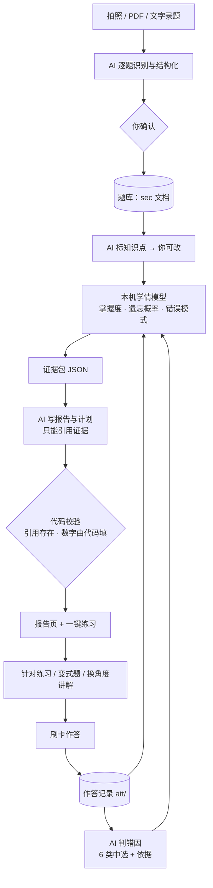

# AI 学情分析与提分：调研与方案

> 目标：能上传题目和错题、记录每次做题，AI 依据这些数据分析学习情况，并带着你把薄弱处补上来。分析结论必须可靠。

## 结论

调研后的核心判断：**大模型适合看懂题、看懂错在哪、把结论讲清楚，不适合直接算掌握度或编造数据**。研究里大模型出错，大多出在三处：识别图片和手写（转写）、在很多候选错因里挑选、自己生成的题答案有误或有多个说得通的答案。所以方案把「算」和「说」分开：

1. **数字全部由本机代码算出来**（正确率、掌握度、遗忘概率、趋势），并给出样本量和可信区间；数据不够时直接显示「数据不足」，不下结论。
2. **大模型只做三件事**：识别和整理题目、判断错因、把本机算好的证据写成报告和计划。每一处都有校验：识别结果要你确认，错因从少量固定类别里选并附依据，报告里的数字由代码填进去，模型写不了数字。
3. **准确度要能量出来**：App 用你后来的真实作答检验掌握度预测准不准（校准度、对数损失），开发时用一套标注好的测试题，在不同模型上测出识别、判题、错因、出题的准确率。

## 一、现状

| 已有 | 位置 | 对本功能的意义 |
|---|---|---|
| FSRS 记忆状态（稳定度 s、难度 d、复习次数、遗忘次数、上次评分） | `020-fsrs.js`、`srs/<课程>` | 可以算出任意时刻的回忆概率 R，是「记忆」维度的现成模型 |
| 错题本（`lapses > 0` 且未移出） | `025-derive.js` `wrongItems()` | 只知道「错过几次」，不知道错在哪、选了哪个错项 |
| 每日汇总、每小节当天的新学 / 复习 / 对 / 错 | `app/state` 的 `stats`、`hist` | 只有计数，没有逐题记录 |
| 资料导入、AI 识别文字、AI 出题 | `120-materials.js`、`ocrSheet()`、`genPrompt()` | 识别和出题的流程可以复用 |
| AI 助手的工具调用（含 `get_weak_points`） | `155-assistant.js` | 分析结果可以作为新工具交给助手 |
| 安全的表达式求值（不用 eval） | `032-viz.js` `compile()` | 可以用来复核计算题的数值答案 |

**缺的关键一环：逐次作答记录**。`rate()`（`090-session.js`）作答后只更新 FSRS 状态和当天计数，选了哪个选项、用了多久、看了几步提示、是第几次做都没有存。没有这份记录，「学情分析」只能根据汇总数字猜，精准无从谈起。所以第一步是补上作答记录。

## 二、调研结论与对方案的影响

| 发现 | 对方案的影响 |
|---|---|
| 手写数学阅卷研究中，最好的模型约 87% 的错误来自**转写**而不是判分；常见问题是图片质量、凭空补内容、等价表达式判错；多行手写公式还会被模型「过度纠正」 | 拍照录题必须有**确认页**：原图和识别结果并排，你确认后才入库；按题目区域逐题识别，不整页一起识别 |
| 小数据上，**PFA / 逻辑回归类知识追踪模型最准**，深度模型（DKT）要大量数据才占优；BKT、PFA 参数少、可解释 | 掌握度用可解释的统计模型在本机算，不用大模型「估计」掌握度；数据多了再拟合 PFA，并用真实作答检验哪个更准 |
| 大模型判断数学误概念：候选少时准确率高（4 选 1 约 92%），**候选越多准确率下降越明显**；总体准确率高也可能掩盖某些题型上的集中失败 | 错因只从 **6 个固定类别**里选，并先用本机规则把候选缩小；按题型分别统计准确率，不只看总数 |
| 大模型自动给题目标知识点，比专家标注差，但和人工修正结合可用 | 题目→知识点由 AI 先标，**候选限定在本课程已有知识点卡**，你可以一键改；未标的题退回按小节归类 |
| 大模型生成的选择题，最常见的问题是**答案错或不止一个答案说得通** | 变式题要经过「不看答案独立做 3 次、多数一致且与给定答案相同」才保留；计算题再用表达式求值复核数值 |
| 多次采样投票（self-consistency）能提高答案可靠性，用程序验证候选答案比单纯投票更好 | 判题和验证答案时多次独立作答投票；计算题让模型同时给出可求值的算式，由代码核对 |
| 实际部署的 AI 阅卷系统都保留「模型多次运行 + 一致性检查 + 人工复核少数异常」 | 模型不一致或置信度低的结果标为「待确认」，不进入分析，等你确认 |

## 三、总体设计



原则：

- **事实只有一个来源**：作答记录和题库。模型的输出不能改写事实，只能附加带来源标记的判断（如错因标签 `by: 'ai' | 'me'`），你的判断优先。
- **不确定就说不确定**：每个结论都带样本量；样本不足、区间太宽、模型多次结果不一致，都显示为「数据不足」或「待确认」。
- **全部在本机**：作答记录和分析都存在设备上，发给模型的只有生成报告所需的证据包。

## 四、模块设计

### 4.1 作答记录（数据底座）

新增文档 `att/<YYYY-MM>`（按月分文件，避免单个文档过大），在 `rate()` 中写入一条：

```js
{
  id: 'ds-1.2-x3k',     // 卡片 id
  t: 1764300000000,     // 作答时间
  m: 'review',          // 来源：learn / practice / review / wrong / star / variant / paper（纸上作答补录）
  g: 3,                 // 评分 1~4
  ok: true,             // 是否答对（题目才有）
  ans: [1],             // 作答内容：选项下标 / 判断真假 / 填空翻开情况 / 问答自评
  ms: 23400,            // 用时：卡片进入视口到作答
  hint: 1,              // 思考题看了几步提示
  r: 0.82,              // 作答前 FSRS 预测的回忆概率（之后用来检验预测准不准）
  first: true           // 是否是当天这张卡的第一次作答（答错后重新排进队列的不算）
}
```

要点：

- 只用「当天第一次作答」计算掌握度，答错后马上重做答对不能抵消。
- `r` 在评分前用 `retr()` 算好存下，这是之后检验模型准确度的依据。
- 用时从卡片进入视口开始算，超过 10 分钟截断（离开 App 的情况）。
- 加入 `DOC_RE` 与云端同步列表，随完整备份导出；旧数据无法补出逐次记录，只从 FSRS 状态生成一条「历史摘要」，分析时单独标注。

### 4.2 题目与错题录入

入口：课程的「资料」页和错题本页增加「录入题目」。

1. **来源**：拍照、相册、PDF、Word、粘贴文字（复用 `058-composer` 的附件和 `120-materials` 的解析）。
2. **逐题识别**：视觉模型先返回每道题的区域，再逐题转写，输出结构化结果：题干、选项、标准答案（有就填）、**你的作答**、题型、原图区域。公式用 LaTeX。
3. **确认页**：每道题一张卡，左边原图裁剪，右边识别结果，可以直接改；标出模型不确定的字段（多次识别结果不一致处高亮）。确认后才入库。
4. **答案来源分级**：
   - 你给的答案或试卷答案：直接用。
   - 没有答案：模型不看你的作答，独立解 3 次，多数一致才填入并标「AI 解答」；计算题同时给出算式，由 `compile()` 复核数值；不一致则标「答案待确认」，这道题不参与判对错和分析。
5. **入库**：存为课程下「我的题目」小节的卡片（`sec/<id>` 文档，沿用现有卡片格式，新增 `src: 'import'`、`img` 原图引用），同时把你当时的作答写成一条 `m: 'paper'` 的作答记录。错题直接进入错题本和 FSRS 复习。
6. **去重**：用 `stableCardId()` 的同一哈希思路，加上题干文字相似度，重复录入时提示合并。

### 4.3 题目→知识点

- 每道题有 `kps: [知识点卡 id]`。内置课程和 AI 生成的内容，在生成时一并标注；录入的题目由 AI 标注。
- **候选限定**：只能从本课程已有的知识点卡里选（先按小节和关键词检索出前 15 个候选，再让模型选 1~3 个），选不出就归到小节层级，不让模型自造知识点。
- 卡片菜单里可以改标注，改过的以你为准（`kpsBy: 'me'`）。

### 4.4 学情模型（本机计算，不用大模型）

**记忆**：每张卡用 FSRS 算当前回忆概率 R；知识点的记忆强度取其知识点卡和关联题目的 R 平均。

**掌握度**：对每个知识点，取关联题目的「当天第一次作答」，按时间衰减加权（半衰期 30 天，越近权重越大），用 Beta 分布估计答对概率：

```
α = 1 + Σ wᵢ·答对ᵢ       β = 1 + Σ wᵢ·答错ᵢ       wᵢ = 0.5^(距今天数/30) ÷ 该题关联的知识点数
掌握度 = α / (α + β)，同时给出 80% 区间
```

状态划分：

| 状态 | 条件 |
|---|---|
| 数据不足 | 有效作答数 Σw < 3 |
| 薄弱 | 区间上界 < 0.6 |
| 已掌握 | 区间下界 ≥ 0.8 且记忆强度 ≥ 0.85 |
| 巩固中 | 其余 |

数据积累后（某课程超过 300 次作答），在本机拟合 PFA 逻辑回归（每个知识点一个难度参数，加上做对、做错次数的系数），用最近 20% 的作答做留出检验；只有对数损失明显优于上面的 Beta 基线才启用。

**错误模式**（纯规则，作为证据和错因的先验）：

| 信号 | 规则 | 倾向的错因 |
|---|---|---|
| 从没做对过 | 该题所有作答都错 | 概念不清 / 方法不会 |
| 做对后隔一段时间错 | 作答前 R < 0.7 | 遗忘 |
| 记得应该很牢却错 | 作答前 R ≥ 0.9 | 概念偏差 / 粗心 |
| 用时很短就错 | 用时 < 该题型中位数的 30% | 审题 / 粗心 |
| 反复选同一个错项 | 同一错误选项 ≥ 2 次 | 稳定的误概念 |
| 依赖提示 | 思考题看完全部提示才做出 | 方法不熟 |

### 4.5 错因诊断

- 固定 6 类：**概念不清、方法不会、记忆遗忘、审题失误、计算失误、粗心**。另可附一句具体的误概念描述（如「把栈顶当成栈底」）。
- 给模型的输入：题目、标准答案和解答、你的作答、上面的规则信号、该知识点的历史作答。
- 输出 JSON：`{ cause, misconception, evidence: '你的作答中……', confidence }`；`evidence` 必须引用你作答里的具体内容，代码检查引用是否真的出现在作答里。
- 规则信号能确定的（如「遗忘」）直接用规则，不调用模型；置信度低或与规则冲突的标「待确认」，在错题卡上一键确认或改选。
- 只统计确认过或高置信度的错因。

### 4.6 AI 学情报告

1. 代码生成**证据包**：知识点掌握度表（含样本量和区间）、错因分布、错误模式、近 30 天趋势、遗忘风险最高的 10 张卡、每条都有 id。
2. 模型按 JSON 输出若干条发现：`{ text, refs: ['kp:ds-3', 'q:ds-3.1-a2'], metrics: ['kp:ds-3.acc'], action }`。正文里的数字一律写成占位符 `{kp:ds-3.acc}`，**由代码替换成真实数值**，模型无法写错数字。
3. 代码校验：引用的 id 和指标都必须存在于证据包；结论涉及的知识点若是「数据不足」，这条发现被丢弃；不通过的重试一次，仍不通过就删去该条。
4. 报告页：图优先（掌握度条形图、错因分布、趋势折线，复用 `032-viz` 的 plot），每条发现下面放一键按钮：针对练习、换角度讲解、出变式题。
5. 交给 AI 助手：新增工具 `get_mastery`、`get_error_patterns`、`get_attempts`，助手回答「我哪里薄弱」时用真实数据。

### 4.7 提高闭环

- **针对练习**：从薄弱知识点里挑题，优先挑预测答对概率在 0.6~0.8 之间的题（太难打击信心，太简单没有收获）。
- **变式题（举一反三）**：针对错题的知识点和错因生成 2~3 道新题；按 4.2 的方法独立验证答案，不通过就丢弃；变式题标 `src: 'variant'` 并关联原题。
- **换角度讲解**：沿用 `genPrompt()` 的 `weak` 参数，附上错因和误概念描述。
- **移出错题本的标准**：原题和至少 1 道变式题在不同的两天都答对后，提示可以移出（现在是手动移出）。
- **每周复盘**：对比上周的掌握度和错因分布，指出哪些已补上、哪些仍薄弱。

## 五、精准度如何保证和度量

不能承诺 100% 正确，但每个环节都有检验，并且能量出来：

| 环节 | 保证手段 | 度量 |
|---|---|---|
| 识别录题 | 逐题识别、多次识别比对、你确认后入库 | 你修改的字段占比 |
| 无答案题的解答 | 独立解 3 次投票 + 算式复核；不一致不入分析 | 测试集上的答案准确率 |
| 知识点标注 | 候选限定在已有知识点、你可修改 | 修改率；测试集准确率 |
| 错因诊断 | 规则先验 + 6 类固定选项 + 引用检查 + 待确认 | 你确认 / 改选的比例；测试集按题型的准确率 |
| 掌握度与遗忘预测 | 本机统计模型，给样本量和区间 | 用之后的真实作答检验：校准曲线、对数损失、AUC，在设置里显示 |
| 报告 | 数字由代码填、引用必须存在、数据不足不下结论 | 自动校验通过率 |
| 变式题 | 盲解验证答案 | 你反馈「题目有误」的比例 |

开发侧：

- `tests/eval/` 放一套标注好的测试数据：题目照片和转写、标准答案、模拟的错误作答和错因标注。
- `scripts/eval-ai.mjs` 用当前配置的模型跑一遍，输出每个环节的准确率，用于比较模型、调整提示词。测试集按学科和题型分组，避免总体准确率掩盖某类题的失败。
- 端到端测试（`tests/e2e.mjs`）里用固定的模拟 AI 回复，测作答记录、学情计算、校验逻辑。

FSRS 参数个性化（后期）：作答记录积累到数百次以上后，可以用 FSRS 开源优化器（有 WebAssembly 版）在本机按你的记录拟合参数，同样只在留出检验更好时启用。

## 六、模型选择

- **识别题目**需要视觉模型：Claude（Opus 5.5 / Sonnet 5.5）、通义千问视觉版、GLM-4V 等；DeepSeek 等纯文字模型不能用于拍照录题，App 会提示更换。
- **解答验证、错因诊断、报告**用推理能力强的模型，Claude 模型的思考强度设为「高」。
- 设置里可以把「学情分析」单独指定一个模型，与日常对话的模型分开。
- 测试集的结果会写进本文档，作为推荐依据。

## 七、隐私

- 作答记录、学情模型、录入的原图都只存在设备上，随完整备份导出。
- 发给模型的只有当次需要的内容：录题时的图片，诊断时的单道题和作答，报告时的证据包（不含原图）。
- 照常只发给你选择的服务商。

## 八、分期实施

| 阶段 | 内容 | 主要改动 |
|---|---|---|
| 1 数据底座 | 作答记录、用时和选项采集、作答前 R、备份与同步 | `090-session.js`、新增 `027-attempts.js`、`005-store.js`、`125-export.js` |
| 2 录题 | 逐题识别、确认页、答案分级、去重、纸上作答补录 | `120-materials.js`、新增 `122-capture.js` |
| 3 学情模型 | 知识点标注、掌握度、错误模式、记录页的学情视图 | 新增 `028-mastery.js`、`087-records.js`、`145-views.js` |
| 4 诊断与报告 | 错因诊断、证据包、带校验的报告、助手新工具 | 新增 `097-diagnose.js`、`155-assistant.js` |
| 5 提高闭环 | 针对练习、变式题验证、错题移出标准、每周复盘 | `090-session.js`、`095-ai-features.js` |
| 6 度量 | 校准度面板、测试集与评测脚本、PFA 与 FSRS 参数个性化 | `tests/eval/`、`scripts/eval-ai.mjs` |

第 1 阶段要尽早上线：作答记录从上线那天才开始积累，越早开始，后面的分析越有数据可用。

## 参考资料

- 手写数学 AI 阅卷，错误主要来自转写：[arXiv 2605.19043](https://arxiv.org/abs/2605.19043)、[arXiv 2603.00895](https://arxiv.org/pdf/2603.00895)、[EMNLP 2026（多行手写公式过度纠正）](https://aclanthology.org/2026.emnlp-main.476.pdf)、[VEHME](https://arxiv.org/pdf/2510.22798)
- 多次运行 + 一致性检查 + 人工复核的阅卷流程：[arXiv 2603.13083](https://arxiv.org/pdf/2603.13083v1)
- 逐步找错：[MathMistake Checker](https://arxiv.org/html/2503.04291v2)
- 知识追踪模型比较（小数据上逻辑回归 / PFA 更准）：[JEDM 2020](https://jedm.educationaldatamining.org/index.php/JEDM/article/download/451/123)、[arXiv 2511.02718](https://arxiv.org/html/2511.02718)、[arXiv 2101.11335](https://arxiv.org/pdf/2101.11335)
- 大模型判断数学误概念：[arXiv 2310.02439](https://arxiv.org/pdf/2310.02439)、[arXiv 2412.03765](https://arxiv.org/html/2412.03765v1)、[AIME-Con 2026](https://aclanthology.org/2026.aimecon-main.33.pdf)、[arXiv 2602.02414](https://arxiv.org/pdf/2602.02414)
- 大模型标注知识点：[arXiv 2511.09935](https://arxiv.org/html/2511.09935v1)、[arXiv 2502.18632](https://arxiv.org/html/2502.18632v2)、[arXiv 2405.20526](https://arxiv.org/pdf/2405.20526v1.pdf)
- 大模型出题的答案错误：[arXiv 2412.01955](https://arxiv.org/pdf/2412.01955)、[arXiv 2312.03173](https://export.arxiv.org/pdf/2312.03173)、[AIME-Con 2025](https://aclanthology.org/2025.aimecon-main.19.pdf)、[BenchMarker](https://www.arxiv.org/pdf/2602.06221)
- 多次采样投票与程序验证：[Self-Consistency](https://arxiv.org/pdf/2203.11171v2)、[PROVE](https://arxiv.org/pdf/2410.12608)、[正反向验证](https://arxiv.org/pdf/2308.07758)
